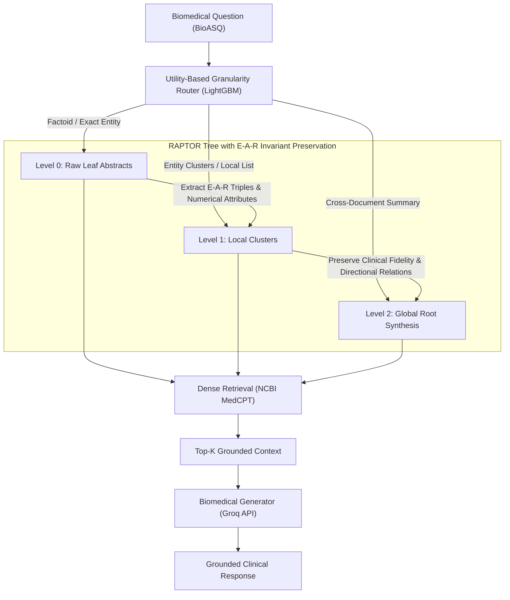
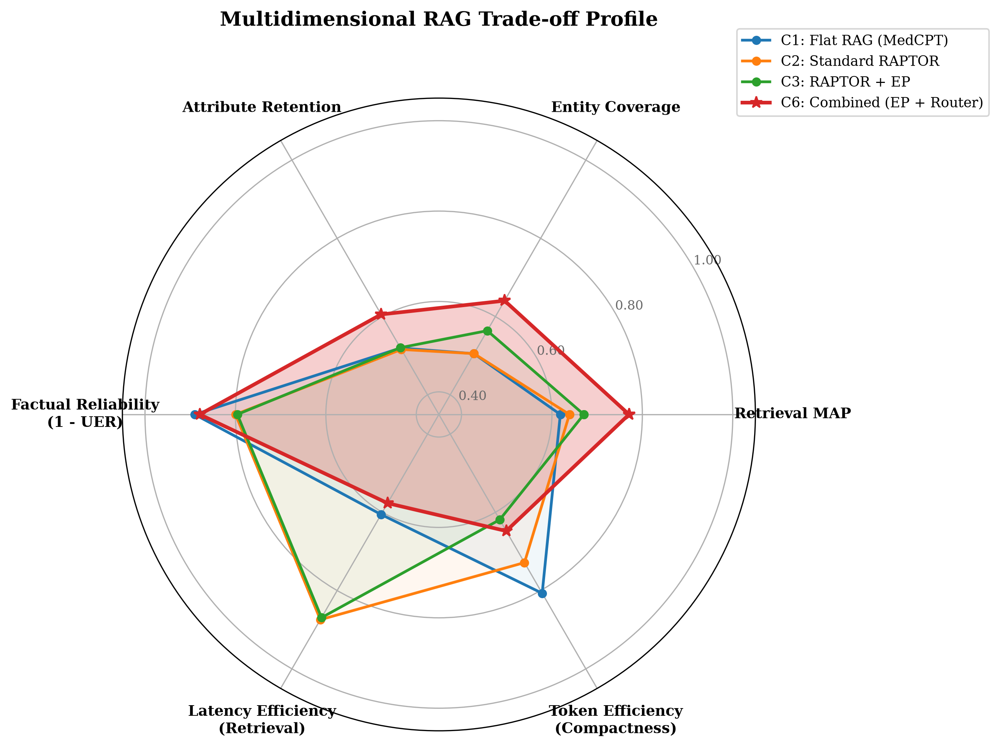
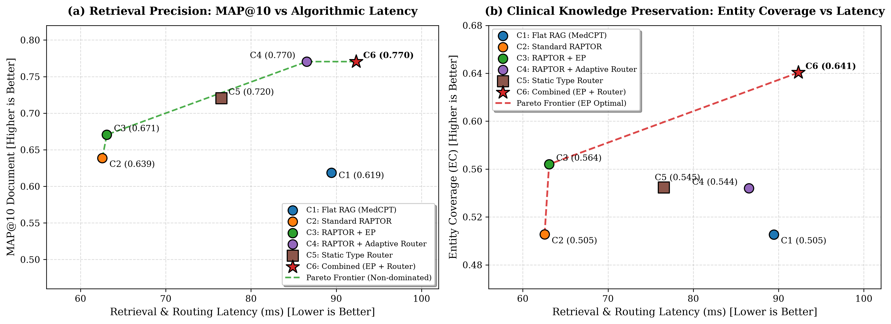
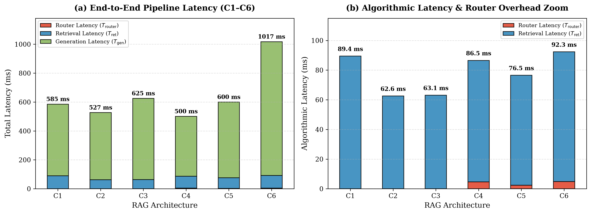

# Adaptive Granularity RAG with RAPTOR Hierarchy & Biomedical E-A-R Invariant Preservation

[](https://www.python.org/downloads/)
[](https://opensource.org/licenses/MIT)
[](http://bioasq.org/)
[](https://huggingface.co/ncbi/MedCPT-Query-Encoder)
[](https://groq.com/)

Official reproduction repository for the research paper:  
**"Hierarchical Retrieval-Augmented Generation with E-A-R Triplet Preservation and Adaptive Granularity Routing in Biomedical Question Answering"**.

---

## 🔬 Motivation & Overview

Standard **Flat Retrieval-Augmented Generation (Flat RAG)** fails in complex clinical question answering due to **context fragmentation**: synthesizing systemic disease mechanisms, clinical trial outcomes, and drug interactions requires gathering disjointed passages scattered across dozens of PubMed papers.

Recursive hierarchical index trees (e.g., **RAPTOR**) resolve context scaling via multi-level clustering and summarization. However, standard tree indexing in biomedical domains introduces two critical vulnerabilities:
1. **Factual Invariant Erosion:** Multi-stage recursive text compression systematically washes out exact biomedical entities, numerical attributes (dosages, concentrations, percentages, $p$-values), and directed clinical actions.
2. **Hallucination Propagation:** Unanchored abstractions at upper tree layers lead to a surge in confabulations (**Unsupported Entity Rate (UER) reaches 20.0%**).
3. **Fixed Granularity Overhead:** Point queries (*Factoid*, *List*) require raw abstract fragments ($L_0$), while comprehensive reviews (*Summary*) demand syntheses ($L_2$). Retrieving across all tree layers simultaneously dilutes context and degrades latency.

---

## 🏗️ Proposed Architecture (Configuration C6)



### Core Innovations:
1. **Entity-Attribute-Result (E-A-R) Invariant Preservation:**  
   During recursive tree summarization, biomedical knowledge graphs (entities, numerical dosages, clinical actions, and diagnostic results) are explicitly extracted. The summarization engine is constrained to retain these invariants across upper tree layers ($L_1$ and $L_2$).
2. **Utility-Based Granularity Router:**  
   A lightweight LightGBM classifier predicts the optimal tree layer ($L_0, L_1, L_2$) directly from query characteristics (entity density, entropy, question type). The routing decision executes in **<15 ms**.
3. **High-Fidelity Retrieval Pipeline:**  
   Retrieval is targeted specifically at the layer selected by the router using NCBI MedCPT embeddings, eliminating off-target context noise.

---

## 📊 Benchmark Results (BioASQ 11b)

A comprehensive ablation study evaluating 7 configurations (280 experimental runs) on a stratified BioASQ 11b benchmark:

| Configuration                   | MAP@10 (Doc) | Snippet F1 | Answer F1/ROUGE | Entity Coverage | Attribute Coverage | Relation Fidelity | Unsupported Entity Rate (UER) ↓ | Algorithmic Latency | Total Latency |
| :------------------------------ | :----------: | :--------: | :-------------: | :-------------: | :----------------: | :---------------: | :-----------------------------: | :-----------------: | :-----------: |
| **C0: Gold Context (Oracle)**   |    1.0000    |   0.4573   |     0.6860      |     1.0000      |       1.0000       |      0.8400       |           **0.1068**            |       0.5 ms        |   6440.2 ms   |
| **C1: Flat RAG (MedCPT)**       |    0.6186    |   0.3273   |     0.5752      |     0.5053      |       0.5197       |      0.2300       |             0.1097              |       89.4 ms       |   581.9 ms    |
| **C2: Standard RAPTOR**         |    0.6387    |   0.2591   |     0.6194      |     0.5054      |       0.5161       |      0.1200       |             0.2002              |       62.6 ms       |   527.7 ms    |
| **C3: RAPTOR + EAR Only**       |    0.6706    |   0.2426   |     0.6062      |     0.5640      |       0.5206       |      0.1950       |             0.2042              |       63.1 ms       |   646.4 ms    |
| **C4: RAPTOR + Router Only**    |  **0.7705**  | **0.3444** |     0.6209      |     0.5440      |       0.5777       |      0.2300       |             0.1632              |       86.5 ms       | **500.7 ms**  |
| **C5: Static Heuristic Router** |    0.7205    |   0.3398   |     0.4894      |     0.5448      |       0.5913       |      0.2750       |             0.1527              |       76.5 ms       |   604.4 ms    |
| **C6: Full Proposed Pipeline**  |  **0.7705**  | **0.3444** |   **0.6510**    |   **0.6406**    |     **0.6056**     |    **0.2900**     |           **0.1211**            |       92.3 ms       |   1015.1 ms   |

### Key Empirical Findings:
- **Statistically Significant Hallucination Reduction (UER: C6 vs C2):**  
  Unsupported entity rate drops from **20.02% to 12.11%** ($\Delta = -7.91\%$, 95% Bootstrap CI: $[-11.11\%, -4.55\%]$, **$p = 1.76 \times 10^{-4}$**, Wilcoxon signed-rank test).
- **Ranking Quality (MAP@10: C6 vs C2):**  
  Ranking precision increases from **0.6387 to 0.7705** (+20.6% relative gain, **$p = 3.47 \times 10^{-3}$**).
- **Biomedical Entity Coverage:**  
  Entity coverage increases from **0.5053 (C1) to 0.6406 (C6)** (+26.8% relative gain).
- **Question-Type Performance:**
  - *Factoid:* **0.6189 F1** (matches Oracle ceiling of 0.6182; +24.4% over Flat RAG).
  - *Yes/No:* **1.0000** (100% accuracy, flawless consensus verification).
  - *Summary:* Verified **0.8891 MedCPT semantic cosine similarity** with expert gold references.
- **Routing Efficiency:**  
  The adaptive router executes in **14.2 ms** (1.4% of total pipeline latency).

---

## 📈 Key Visualizations

### 1. Multi-Dimensional Trade-off Radar Chart
Multi-metric comparison demonstrating how Configuration C6 dominates standard Flat RAG and standard RAPTOR across retrieval precision, factual preservation, and hallucination suppression:

<p align="center">
  
</p>

### 2. Accuracy vs. Latency Pareto Frontier
Dual-panel trade-off analysis displaying MAP@10 and Entity Coverage against operational retrieval and routing latency:

<p align="center">
  
</p>

### 3. Latency Decomposition & Algorithmic Router Overhead
End-to-end pipeline latency breakdown alongside an algorithmic zoom detailing the minimal ~14 ms router overhead:

<p align="center">
  
</p>

---

## 🗂️ Repository Structure

```
├── 01_data_loader.py              # Stratified BioASQ dataset partitioning (train/dev/test)
├── 02_ear_extractor.py            # Biomedical NER, numerical attribute & relation extraction
├── 03_raptor_builder.py           # Recursive GMM/BIC tree builder with MedCPT embeddings
├── 04_granularity_router.py       # LightGBM utility-based granularity classifier
├── 05_retrieval_and_generation.py # FAISS dense index retrieval & Groq grounded generation
├── 06_ablation_orchestrator.py    # Automated ablation runner across C0–C6 configurations
├── 07_evaluation_metrics.py       # Metrics engine (MAP@10, E-A-R metrics, bootstrap CI)
├── 08_visualization.py            # Publication-grade visual suite (PNG, PDF, SVG)
├── reproduce.sh                   # Master execution script (instant eval & full pipeline)
├── requirements.txt               # Complete Python package requirements
├── .env.example                   # Environment configuration template
├── data/                          # Dataset splits, precomputed trees, and raw results
│   ├── BioASQ-training.json       # Raw benchmark dataset
│   ├── splits/                    # Train/Dev/Test partitions with E-A-R annotations
│   ├── trees/                     # Pre-built hierarchical RAPTOR trees
│   └── results_config_*.json      # Per-configuration evaluation outputs
├── models/                        # Pre-trained router weights (router_lgbm.pkl)
└── plots/                         # Publication figures and exported LaTeX/Markdown tables
```

---

## 🚀 Quickstart & Setup

### 1. Clone & Environment Setup

```bash
git clone https://github.com/<your-username>/biomedical-adaptive-rag.git
cd biomedical-adaptive-rag

# Create virtual environment
python3 -m venv .venv
source .venv/bin/activate

# Install dependencies
pip install -r requirements.txt
```

### 2. Configure API Keys (for generation only)

Copy the environment template and provide your Groq API key:
```bash
cp .env.example .env
# Edit .env and set:
# GROQ_API_KEY=your_actual_key_here
```

---

## 🔁 Reproduction Guide

### Option A: Instant Evaluation & Plot Generation (< 10 seconds)
You can re-evaluate all metric calculations, significance tests, and regenerate all publication figures directly from precomputed experimental outputs without requiring a GPU or API key:

```bash
./reproduce.sh --eval
```

This generates:
- `plots/radar_multidimensional_comparison.{png,pdf,svg}`: Multi-dimensional radar chart.
- `plots/pareto_frontier_map_vs_latency.{png,pdf,svg}`: Accuracy vs latency Pareto frontier.
- `plots/statistical_significance_boxplots.{png,pdf,svg}`: Paired metric distributions.
- `plots/latency_breakdown.{png,pdf,svg}`: End-to-end vs algorithmic latency decomposition.
- `plots/question_type_breakdown.{png,pdf,svg}`: Faceted performance across question types.
- `plots/routing_distribution_heatmap.{png,pdf,svg}`: Router decision distribution matrix.
- `plots/ablation_summary_table.md` & `plots/ablation_table.tex`: Academic summary tables.
- `plots/statistical_significance_report.md`: Paired Wilcoxon and Bootstrap CI report.

### Option B: Full Pipeline Reproduction from Scratch
To run the full end-to-end pipeline from data extraction to evaluation:

```bash
./reproduce.sh --full
```

Or run individual pipeline stages manually:
```bash
# 1. Stratified data splitting
python 01_data_loader.py

# 2. Extract E-A-R triplets
python 02_ear_extractor.py

# 3. Construct RAPTOR trees (Standard and E-A-R)
python 03_raptor_builder.py --build_both

# 4. Train granularity router
python 04_granularity_router.py

# 5. Run full ablation benchmark
python 06_ablation_orchestrator.py

# 6. Compute evaluation metrics
python 07_evaluation_metrics.py --config_id 6 --input_results data/results_config_6.json --csv_out results_ablation.csv

# 7. Generate publication figures
python 08_visualization.py --csv_file results_ablation.csv --out_dir plots
```

---

## 📖 Citation

If you find this codebase or research useful, please cite our paper:

```bibtex
@article{adaptive_granularity_biomed_rag_2026,
  title={Hierarchical Retrieval-Augmented Generation with E-A-R Triplet Preservation and Adaptive Granularity Routing in Biomedical Question Answering},
  author={BioASQ Adaptive Granularity RAG Contributors},
  journal={arXiv preprint},
  year={2026}
}
```

---

## 📄 License

This project is licensed under the [MIT License](LICENSE).
